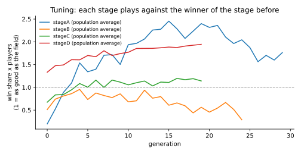
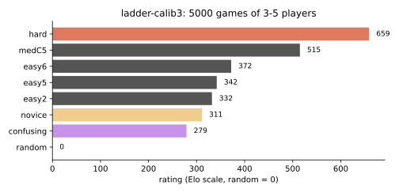
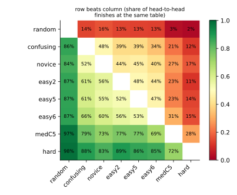
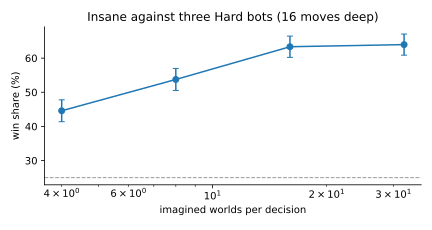
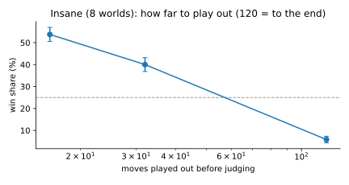
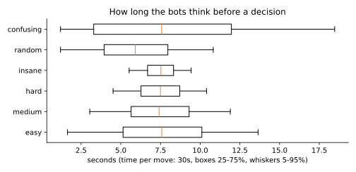

# Koehandel bots: how they were built

This folder holds the research behind the bots you can add to a table: the training and evaluation scripts, the
raw results and the charts. The bots themselves live in `lib/bots/` and run on the server (none of it ships to
the browser). This page is for whoever works on them next.

## Summary

| Level | What it is | Strength |
|---|---|---|
| Random | uniformly random legal moves | rating 0 (the anchor) |
| Confusing | sensible play with chaotic generosity (see below) | ~280 |
| Easy | the brain with naive habits, calibrated to a novice player | ~330 (novice stand-in: ~310) |
| Medium | Hard's judgement played imprecisely | ~515 |
| Hard | the brain with parameters tuned by self-play | ~660 |
| Insane | Hard + Monte Carlo search over imagined hidden cards | wins 63% of 4-player games against three Hard bots (fair share 25%) |

Ratings are Bradley-Terry ratings on the Elo scale from 5000 mixed bot tables (`runs/ladder-calib3.json`).
200 points means the stronger side finishes ahead about 76% of the time. No GPU or neural network was needed:
the strength comes from a small model of the game, tuned parameters and search.

## The problem, from a bot's point of view

A bot faces six kinds of decision: on its turn (auction the next animal, or start a koehandel and with whom),
in an auction (how far to bid), as auctioneer (sell, or buy the animal back), when paying (which cards), as the
starter of a koehandel (how much to offer, and with how many cards) and as its target (accept, or counter with
how much).

What makes Koehandel hard for a computer:

- **Hidden information.** Other hands are secret (only card counts are visible), koehandel amounts stay secret,
  the deck order is unknown, and with a smaller deck even the number of each animal is unknown.
- **3 to 5 players**, so there is no single opponent to "beat"; what matters is finishing first.
- **Huge, continuous-ish moves.** Bids are any multiple of 10; offers are any subset of a hand of up to ~20 cards.
- **Real-time auctions** where everyone may bid at any moment.
- **A tiny compute budget.** Bots run inside a serverless request (Vercel), so a decision gets a few hundred
  milliseconds of one CPU at most, with no GPU.

### Options considered

| Approach | Verdict |
|---|---|
| Minimax / exhaustive tree search | Out: imperfect information, 3-5 players, simultaneous bidding and a branching factor in the thousands. |
| Neural network trained by self-play (RL, AlphaZero-style) | Possible, but it needs millions of games and careful design of inputs for card subsets and hidden money, and the result is a black box that is hard to tune into "easy" and "medium" versions. The gain over a well-tuned model of the game is uncertain for a game this size. Kept as a future step (see the end). |
| Hand-written rules | Fast and explainable but brittle: rules of thumb break in situations nobody thought of. Used only for the "novice" stand-in that calibrates Easy. |
| **A small model of the game + tuned parameters + Monte Carlo search** | **Chosen.** One principled evaluation function drives every decision; its 17 parameters are tuned by self-play with an evolution strategy; Insane adds determinized Monte Carlo playouts on top. Fast, explainable, and it gives natural knobs for the easier levels. |

## The brain (`lib/bots/brain.js`)

### What a bot may know

`observe(state, i)` builds everything a bot is allowed to use: its own cards, everyone's animals and card counts,
the deck size and what has been drawn, the recent koehandels, and **money estimates** the engine keeps for this
purpose: a public ledger (start money, mule payouts and auction prices, which everybody sees) plus what this player
privately learned (amounts in its own koehandels, overpayments it received). Bots never read other hands, the deck
order or the secret composition of a smaller deck.

### The position model

For every animal type, each player's chance to end up owning the whole set is modelled as

```
strength(j, t) = (held(j, t) + rho * stillToCome(t) / players) ^ gamma  *  (money(j) + mu) ^ delta
chance(j, t)   = strength(j, t) / sum of strengths
```

From those chances follows each player's expected final score under the real scoring (sum of set values times the
number of sets, computed exactly for independent sets), and a soft chance to win:

```
E(j)   = expected score of j
win(i) = exp(E(i) / tau) / sum_j exp(E(j) / tau),     tau = tau0 * (average E + tau1)
```

`win(i)` is the bot's sense of "how good is this position for me". Every decision compares it before and after:

- **Bidding:** the highest price at which "I get the animal and pay this" still beats "someone else gets it
  (weighted by who likely wants it) and pays this to the auctioneer", found by binary search. Auctions are English
  auctions, where bidding up to your true value is the right strategy, so the bot just needs a good value.
- **Auctioneer:** buy back if "I keep it and pay the bidder" beats "the bidder pays me".
- **Koehandel offer:** every amount the hand can make is scored by `(1 - q) * win(I win the animals, pay x) +
  q * win(they win them, I get the difference)`, where `q` is the chance the other player can and will beat `x`
  (from their estimated money). The cards are the exact amount with the fewest cards, padded with zeros to bluff.
- **Answering a koehandel:** the offer is unknown; the bot guesses it from the number of cards, the attacker's
  average card value and estimated money (five weighted guesses), then compares accepting with every possible
  counter (the higher offer wins and the offers swap hands, ties as in the rules).
- **Turn:** an auction is worth the position plus some expected income; each koehandel is worth its best offer's
  score. Animals left by players who are gone are taken for free.

Unknown deck composition (smaller decks) is handled exactly: every composition of 2-4 per type that adds up to the
deck size is equally likely up front, and drawing `s` cards of a type that has `c` copies has likelihood
`c!/(c-s)!`, so the bot computes the expected number still to come for each type (cached).

### A subtle failure: endless koehandels

Once the deck is empty a koehandel is compulsory. With uneven holdings (2 against 1) whoever wins can simply
reverse them, and early versions of the bots did that forever (up to 4% of self-play games never ended). Only a
win by the bigger holder ends such a contest, so the table now remembers recent koehandels and on a repeat the
bigger holder plays to win while the smaller one lets go. Since then no simulated game has failed to finish.

## Tuning (`scripts/tune.mjs`)

The 17 parameters are tuned with **sep-CMA-ES** (Ros & Hansen 2008), a derivative-free evolution strategy that is
robust to noisy fitness. Each generation samples 16 parameter sets; each one plays **duplicate deals** against a
fixed field at 3, 4 and 5 players: every deal is played once with the candidate in each seat, which removes most of
the luck of the cards and of the seating. Fitness is win share times players (1.0 = exactly as good as the field).
All candidates of a generation see the same deals (common random numbers), so differences are real differences.

Tuning runs in stages, each against the winner of the one before, so the bot does not just learn to exploit one
opponent:

| Stage | Field it was tuned against | Result (4 players, fair share 25%) |
|---|---|---|
| A | the hand-set default parameters | wins 70% against three default bots |
| B | stage A (pure self-play) | wins 32% against three stage-A bots |
| C | stages B and A | 35% against three B bots, 43% against three A bots |
| D | C, B, the novice, the defaults and Easy | better against weak players (63% vs 55% against novices) but only 21% against C |

Hard uses **stage C**: in mixed tables C and D rate the same (560 vs 550 in `runs/ladder-stages.json`) and C wins
the head-to-head. A lesson for future tuning: the field matters a lot. Stage A, tuned against weak bots, learned
to overbid (it beats novices 66% of the time but loses to everything later); self-play stages learned restraint.



The tuned parameters are in `lib/bots/params.js` (from `runs/stageC.params.json`). Each stage logs one line per
generation in `runs/stage*.jsonl`.

## Difficulty levels

- **Hard**: the stage-C parameters, played exactly.
- **Medium**: the same parameters, but every price it comes up with is blurred (lognormal noise, sd 0.5) and 20% of
  its turn choices are careless. It rates about halfway between Easy and Hard.
- **Easy**: see below.
- **Insane**: Hard plus search, see below.

### How "Easy" was calibrated

There is no data on real beginners, so `scripts/novice.mjs` stands in for one: a player who knows the rules and
the animal values and follows the rules of thumb new players use (bid on valuable animals and ones you already have,
buy back what you collect, koehandel when you have a pair, offer a chunk of your money, defend what you own).
Easy was then made weaker until it wins exactly as often as that novice. Simply adding randomness made it play
erratically, which is not what a beginner does, so Easy instead gets *naive habits*: it bids timidly, sees sets
as worth little more than their animals, cares little about money, and still slips now and then.

In mixed tables Easy rates 292-332 across three tournaments against the novice's 300-336, so the two are level.
Its settings: `shade 0.9, mBid 0.1, gamma 1, delta 0.25` (`lib/bots/params.js`), noise 0.35 and 15% careless
turns (`lib/bots/index.js`).

### Ratings

Ratings come from mixed tables (3-5 bots of random levels, `scripts/ladder.mjs`), turned into Bradley-Terry
ratings on the Elo scale from every pair of seats in every game (higher score wins the pair), with Random at 0.
200 points means the stronger side finishes ahead about 76% of the time.





`ladder-stages` rates the tuning stages against each other and the other bots; `ladder-calib` and `ladder-calib2`
are the calibration runs for Easy and Medium (the candidate specs are in `runs/specs.json`).

## Insane: Monte Carlo search (`lib/bots/insane.js`)

Insane starts from Hard's judgement and checks it by simulation. Before a big decision it lists a few candidate
moves (Hard's own move and alternatives around it: other bid limits, offers, counters, koehandel targets), then:

1. **Imagines the hidden part of the table**: the money cards it cannot see are dealt over the other players with
   their visible card counts (of several random deals, one that fits the money estimates and any standing bid is
   kept), an offer lying face down becomes some of that player's imagined cards, and the rest of the deck (and, with
   a smaller deck, its composition, drawn from the exact posterior) is shuffled.
2. **Plays every candidate out** in the same imagined worlds, everyone playing as Hard, for a fixed number of moves,
   then scores the result with the position model (or the real result if the game ended).
3. Picks the candidate that did best.

This is "determinized" Monte Carlo (perfect-information Monte Carlo) used as a one-step policy improvement over
Hard. Using the same worlds for all candidates (common random numbers) makes even a few dozen playouts informative.
The budget is fixed (not time-based) so a bot move is the same whichever request triggers it.

### Results

Insane in one seat against three Hard bots, 60 duplicate deals (240 games) per setting (`runs/exp-vs-hard.json`):

| Imagined worlds | Moves played out | Win share (fair 25%) |
|---|---|---|
| 4 | 16 | 44.6% ± 3.2 |
| 8 | 16 | 53.8% ± 3.2 |
| **16** | **16** | **63.3% ± 3.1** (used live) |
| 32 | 16 | 64.0% ± 3.1 |
| 8 | 32 | 40.0% ± 3.2 |
| 8 | to the end | 5.8% ± 1.5 |
| 16 | 1 | 4.6% ± 1.3 |





The depth matters more than anything:

- **Too short (1 move):** the candidate's own auction or koehandel has not resolved yet. The candidates look nearly
  the same, so the choice is noise.
- **Too long (to the end):** a finished game is a plain win or loss. With 8 samples per candidate that is mostly
  luck too.

Either way the bot picks among its candidates almost at random. The list deliberately includes extreme options
(bid nothing, overbid, all-in offers), so random choices are worse than Hard. Sixteen moves resolves the move and
what follows, and the brain's smooth estimate judges the rest. Beyond 16 worlds the gain flattens.

Cost: with 8 worlds a decision took a median of 53 ms (p90 116 ms) on a laptop core while other work was running.
16 worlds is roughly twice that, which fits a serverless request.

## Thinking time and bidding speed

Bots wait before moving so they feel like players: on average a quarter of the table's time per move (capped at
10 seconds so long limits do not drag; paying takes half as long), with a spread that shrinks as the level goes up.
The Confusing bot is all over the place. In auctions they answer a bid after 1.5-2.6 seconds on average, raise in
small steps (bigger when far below their limit) and always bid before the clock runs out.



## Random and Confusing

- **Random** makes uniformly random legal moves (random bids, random koehandels, random cards).
- **Confusing** plays like a sensible player on a very strange day. It makes generous koehandel offers (more than
  the other player could ever counter, or half its money), lets lowball offers slide, pays with big notes instead
  of exact change, sometimes bids animals far beyond their worth and sometimes lets bargains go, and picks odd
  koehandel targets. It is not trying to lose, but its gifts move money around the table in ways nobody sees
  coming: the player it lets off cheap may suddenly out-money the next one in their koehandel.

## Smaller decks

The bots handle the secret composition exactly (see above) and the test suite plays full bot games with 24- and
26-card decks. Their parameters were tuned on the normal 40-card deck only; `scripts/tune.mjs` accepts a list of
deck sizes (`22,26,30,34`) for a separate tuning run if smaller decks turn out to need it.

## Reproducing

```bash
node agent/scripts/tune.mjs stageA 30 '[{}]'                       # stage A against the default parameters
node agent/scripts/match.mjs '<spec json>' '<field json>' 400       # one duplicate match
node agent/scripts/ladder.mjs agent/runs/ladder.json 1500           # mixed tables of every level
node agent/scripts/insane_exp.mjs '<hard params>' 40 8:16,16:16     # Insane against Hard at several budgets
python agent/scripts/analyze.py                                     # charts in agent/img, summary in runs/
```

A spec is `{"kind":"smart","th":{...},"noise":0,"slip":0}`, `{"kind":"insane","th":{...},"worlds":8,"depth":16}`,
`{"kind":"random"}`, `{"kind":"confusing"}` or `{"kind":"novice"}`. Scripts use every core but one.

## Ideas for whoever continues

- **Tune for smaller decks** (see above), and measure the levels' ratings at 20-30 cards.
- **Shorter playouts that stop when the move has resolved**: play until the auction or koehandel is settled, then
  a fixed number of moves. That should fix depth sensitivity and allow fewer, cheaper playouts.
- **A learned evaluation**: the position model's chances could be replaced by a small network trained on Insane's
  self-play outcomes (features: holdings, remaining cards, money estimates). Insane's playouts would then judge
  their end positions better, and Hard would improve directly.
- **Opponent modelling**: track how each real player bids and offers and adjust the guesses about their koehandel
  offers (`offerGuesses`) and their limits.
- **Bluffing on purpose**: the zero-card padding is a single tuned ratio. A mixed strategy that depends on the
  situation could be learned.
- **Re-tune Medium and Easy whenever Hard changes**: their ratings are relative.
